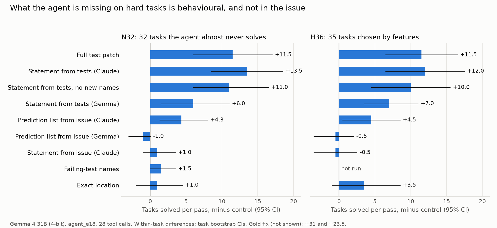

# Obvious in Hindsight: What a Small Quantized Coding Agent Is Missing on Hard Repair Tasks

## Abstract

Small, open coding agents are attractive – they are cheap to run and can be deployed on local hardware – but they solve far fewer repair tasks than their larger counterparts. The natural response is to improve the harness around the model: better prompts, more tool calls, sub-agents, fine-tuning. In this work, we ask a different question – is a small agent failing for lack of process, or for lack of information? We study Gemma 4 31B (4-bit, 32k context, 28 tool calls, 8 minutes per task) on SWE-bench-style repair, with 52 pre-registered experiments and every comparison made within task. On 32 tasks the agent almost never solves, we add one kind of information to the issue at a time: the exact location of the fix adds 1.0 task, the failing tests add 11.5, and a behavioural statement of at most 50 words written from the tests adds 13.5. This pattern replicates on 35 tasks chosen by their features alone and on a second agent. However, the statement cannot be recovered from the issue – written from the issue alone, it adds nothing. Only 9% of the requirements that the hidden tests impose are arbitrary; most look inferable once the tests have been seen, yet writers predicting the tests from the issue anticipate only 46% (Claude) and 24% (Gemma) of them. A stronger model's prediction list recovers about a third of the gain, the agent's own list recovers none, and no process change we tested moved solves by more than our experiments could detect. At 4B parameters, the agent cannot use even the tests. In short, for this class of agent the wall is behaviour that is obvious in hindsight – and absent from the issue.

## Introduction

Coding agents – a language model in a loop with tools that read, edit, and run code – have become a popular way to automate software repair, with SWE-bench (Jimenez et al. 2023) and its descendants serving as the standard testbed. Most of the progress on these benchmarks has come from large, closed models. The Gemma 4 Developer Agent competition asks what a small, open model can do. The model is fixed (`gemma-4-31b-it-qat-w4a16-ct`, a 4-bit quantized 31B model), the harness is fixed (Google ADK, configured through declarative YAML), and the hardware is fixed (4×L4 GPUs, 12 hours for about 120 hidden tasks). The only thing a competitor can change is the agent itself – its prompts, tools, sub-agents, budgets and, optionally, a LoRA adapter.

Over 67 agent versions we did exactly that. Fifteen pre-registered design changes showed no gain beyond noise, and our Kaggle submissions clustered at 8-10 of 58 tasks regardless of the design. Rather than try a sixteenth change, we stepped back and asked what the agent is actually missing:

1. Which information, if supplied, makes the agent succeed?
2. How little of that information suffices?
3. Could the agent have derived it from the issue?

This work contributes:

- an information ladder on hard tasks, showing that the agent lacks the intended behaviour rather than the location of the fix
- an issue-only foresight test – writers predict the hidden tests from the issue alone – which separates behaviour that is inferable in hindsight from behaviour that is actually anticipated
- a set of process ablations, each reported with its minimum detectable effect, and a scale boundary at 4B parameters where the information wall becomes an ability wall

In the rest of the paper we first discuss related work, then describe our agents, task sets, and measurement protocol, and finally present the results, limitations, and implications.

## Related Work

The closest work to ours is ORACLE-SWE (arXiv 2604.07789), which supplies five kinds of oracle information to coding agents and finds the reproduction test the strongest signal on every benchmark and across the (strong) models tested. We confirm this ordering for a weak 4-bit agent at a 28-call budget, and we add a dose curve, the issue-only and foresight arms, and a scale boundary. On the benchmark side, OpenAI's SWE-bench Verified annotation flagged 38.3% of 1,699 tasks for under-specified issues and 61.1% for tests that may reject valid solutions. Our foresight test is a behavioural counterpart to that annotation, run on tasks that were not filtered this way – and, interestingly, it finds arbitrary requirements rare (9%) but unanticipated inferable ones common.

Ambig-SWE (arXiv 2502.13069) and "Asking What Matters" (arXiv 2604.14624) take the opposite approach – they remove information from issues and let agents query a simulated user who holds the full issue. We instead measure what natural, complete issues still lack relative to the tests, which is information such a user could not supply. Agentless (arXiv 2407.01489) generated reproduction tests that reproduced the issue for 213 of 300 SWE-bench Lite problems, yet only 94 of them reported the issue resolved after the ground-truth patch was applied – the same failure we see when our agent writes its own contracts. Finally, on a 45-task hard subset, reruns and harness swaps each flip 13% of tasks at the median, against 22% for a model swap (arXiv 2610.04433). Our agent-identity share of variance (0.17%) sits at the weak-model end of that range.

Within this competition, other entries have focused on where the fix lives and how to reach it faster – e.g., code-graph features that predict failure (*Where the Fix Lives*) and code-graph localisation tools (*TopoSWE*) – as well as on time budgets and scaffolding. Our results are complementary: on the tasks this agent fails, it usually reaches the right files but implements a behaviour other than the one the tests require, and the exact location alone buys about one task.

## Methodology

**Agents.** We use two agents with the same budget (28 tool calls, 8 minutes). `agent_e18` is a public Apache-2.0 single-agent bundle, which we modified only to pin the issue against context compaction. `agent_e10` is our own test-first agent – it writes a check that must fail on the unedited code before it edits anything.

**Task sets.** Since the hidden tasks come from repositories we cannot see, we built our own sets from other sources:

- *rb64* – 64 SWE-rebench tasks from 57 repositories, converted to the competition sandbox with date-pinned wheels and validated (the gold patch passes, the empty patch fails). The agent solves about 36% of them.
- *N32* – the 32 rb64 tasks with a historical solve rate under 0.1, which account for 78% of all failures. As a note, this set is selected on outcomes.
- *H36* – 35 tasks chosen by features alone (no code in the issue, at least 3 gold hunks), with a control solve rate near Kaggle's level (about 20%). This is the replication that does not share N32's selection bias.
- *OOD-45* – an external set of 45 bug fixes, used to check for regressions.

**Noise.** On rb64, the task explains 71% of the variance between attempts, while the identity of the agent explains just 0.17%. The pass-to-pass standard deviation (2.08 tasks) equals the binomial value (2.06), i.e., the variation is what one would expect from coin flips. In practical terms, a one-task gain needs dozens of passes to detect, while an effect of 10 tasks needs only two.

**Protocol.** Every experiment has a pre-registration – its assumptions, predictions, and decision rule – committed before the run. The arms of an experiment run interleaved and differ in exactly one thing, and a script verifies that each information arm differs from the control only in the appended section. The unit of measurement is tasks solved per pass. We test with one-sided within-task sign-flip permutations and task-bootstrap confidence intervals, Holm-corrected over the full family of 43 contrasts, and every null result is reported with its minimum detectable effect (MDE). Information arms never enter training data or submissions, which is enforced by `train/oracle_guard.py` and `scripts/preflight.sh`.

*Figure 1: The gain on hard tasks for each kind of information appended to the issue (tasks solved per pass minus the control, with 95% CIs). We see that the location of the fix buys almost nothing, while the tests – or a short statement written from them – buy most of what is available. The gold fix, not shown, gives +31 (N32) and +23.5 (H36).*

## Results

### The agent lacks behaviour, not location

| Added to the issue | N32 Δ [95% CI] | H36 Δ |
|---|---|---|
| Exact location (files, lines, function) | +1.0 [−2.0, +4.5] | +3.5 [−1.5, +8.5] |
| Failing-test names | +1.5 [0.0, +3.0] | |
| One hunk of the test patch | +10.0 [+5.5, +15.0] | |
| Full test patch | +11.5 [+6.5, +16.5] | +11.5 [+6.5, +16.5] |
| Statement from the tests, ≤ 50 words, no code | +13.5 [+8.5, +18.5] | +12.0 [+7.0, +17.5] |
| Same, names and values absent from the issue removed | +11.0 [+6.0, +16.0] | +10.0 [+4.5, +15.5] |
| Gold fix | +31.0 | +23.5 |

*Table 1: Tasks gained per pass when one kind of information is added to the issue, relative to the control.*

Somewhat surprisingly, location is not the wall. Telling the agent exactly where to edit doubled the share of attempts that touched every gold hunk (35% to 73%), yet it bought about one task. Applying a known fix is not the wall either – given the gold diff, the agent solves every task. The tests, on the other hand, buy 11.5 tasks on both sets, and a 50-word prose statement written from them does just as well, with or without the exact names. For example, the statement for one task (loguru_1306) reads: "Colour detection honors FORCE_COLOR as well as the existing variable that disables colour. A non-empty FORCE_COLOR enables colour on a non-terminal stream; an empty one does not…". In lay terms, the agent needs to know which inputs matter and what must happen to them – it does not need executable tests or new identifiers. Indeed, in 9 of the 14 tasks that flipped to solved under the tests, the agent's patch came before it ever ran them.

The result also holds for our second agent: `agent_e10` gains +12.0 from the tests and +5.5 from the name-free statement, and both pre-registered gates passed. Since this agent is built around running a check, it is perhaps unsurprising that it gains less from prose than from tests. All test-informed contrasts survive Holm correction.

### The missing behaviour is obvious in hindsight and absent from the issue

**From the issue, nothing.** If the same writers, with the same 50-word limit, see only the issue and the repository, their statements are worth +1.0 (Claude) and −0.5 (Gemma) on N32, and −0.5 each on H36. When Gemma is shown the tests, on the other hand, its own summary recovers about half of Claude's gain (+6.0 on N32; +7.0 on H36, Holm 0.025).

**Not arbitrary detail.** A reviewer's first objection would likely be circularity – the tests grade the agent, so of course the tests "help", perhaps through details nobody could guess. To address this, we listed the 236 requirements that the hidden tests impose on the 62 hard tasks and classified them (one Claude rater, with the tests in view): 36% are stated in the issue, 36% are inferable from the issue and repository, 19% are a defensible choice, and only 9% are arbitrary. A second rater (Gemma) was too lenient to agree at the task level (κ 0.00, a pre-registered failure), so we draw no task-level split from it.

**Not anticipated.** Of course, raters who see the tests are judging in hindsight. To test foresight directly, two writers saw only the issue and listed what the tests would check, and a blind judge scored those lists against the requirements.

| Requirement kind | Claude writer recall | Gemma writer recall |
|---|---|---|
| Stated in the issue | 92% | 79% |
| Inferable, in hindsight | 46% | 24% |
| Defensible choice | 31% | 10% |
| Arbitrary | 10% | 2% |
| All | 57% | 38% |

*Table 2: Recall of the hidden-test requirements by writers who saw only the issue, split by the kind of requirement.*

The gap is mostly behaviour that looks inferable once the tests are seen, but is not anticipated from the issue – and the agent's own model anticipates the least of it. As a note, both the lists and the judge are Claude, so a same-family bias toward the Claude writer is possible.

**Anticipation helps in proportion to its recall.** Given Claude's issue-only prediction list (up to 8 concrete behaviours), the agent gains +4.3 on N32 (p 0.017) and +4.5 on H36 (p 0.020), or about a third of the test-informed gain. These come from three passes against two controls and are not significant after Holm correction over all 43 contrasts, so we treat them as suggestive. Given Gemma's list, the agent gains nothing (−1.0, −0.5). When asked to write its own list before editing (`agent_e26`), it does so in 60% of attempts and still gains nothing (pooled −1.0 per pass). In other words, the agent cannot close the gap by predicting the tests itself.

### Why process changes do not help

| Change (pre-registered) | Result | MDE |
|---|---|---|
| 40 calls / 10 min (4 passes) | rb64 +2.5, OOD −0.2; over Kaggle's 12 h | 4.6 |
| 100 calls / 30 min | F51 17 vs 12; empties 6 → 1, wrong 33 → 33 | |
| Three-agent chains | OOD 33.5 vs 39.5 (p 0.004) | |
| Completeness prompt | H36 0.0, rb64 −3.0 | 3.8 |
| LoRA on own successes (162) | unseen tasks −0.5 | 1.0 |
| Agent predicts the tests first | pooled −1.0 | |

*Table 3: Process changes, their results, and the minimum detectable effect where a null was the outcome.*

A larger budget mostly converts empty attempts into wrong ones (empties 29 → 13 of 256, wrong 127 → 133). Of the wrong patches, 81-88% fail only the new tests and break nothing else, and on H36, 20 of 46 such misses involve an interface the tests expect but the issue does not state. Put simply, the agent finds the right place, keeps the code working, and implements a plausible behaviour – which happens to differ from the hidden one. Process changes buy more chances at the same guess. Consistent with this, our Kaggle submissions drew 4-10 of 58 over 15 draws, and our best file (8-10 per draw) is not distinguishable from our first working agent.

### At 4B the information wall becomes an ability wall

With Gemma E4B under the same harness, rb64 falls to 11 tasks per pass (the 31B solves 22). The tests add only +2.0 on N32 (31B: +11.5), the name-free statement +0.5, and a larger budget nothing, since E4B stops on its own at a median of 8-10 calls. However, this is not simply early stopping – given the gold fix, E4B solves 20 of 32 hard tasks, and our test-first agent, which runs longer, still gains only +1.0 from the tests. We also tried distilling 240 solved 31B runs into E4B (LoRA, held-out loss −0.16 nats). This taught persistence without judgement: calls rose to the cap, attempts looped into timeouts, and solves fell from 10.5 to 3.5. Seemingly, at 4B the model can apply answers but cannot derive them from a specification. On Kaggle's small-model track, E4B scored 0.06.

## Limitations

Transfer to the hidden set is untested – our instruments rank designs, but there are too few Kaggle draws to check that those rankings carry over, and H36 only approximates Kaggle's level. We studied one model family, two agents, and one smaller size. The test-informed statements stand in for a developer who knows the intended behaviour, not for anything an agent has. Most arms have two passes, so effects under about 4 tasks are not excluded. The requirement classes come from one rater, and the foresight judge is Claude. Finally, research agents (Claude) wrote analysis scripts and labels under human direction; the scripts reproduce every count.

## Conclusion and Future Work

In this paper we have found that a small, quantized coding agent lacks behaviour, not location – and that this behaviour, while mostly inferable in hindsight, is neither in the issue nor reliably anticipated by the agent or a stronger model. This leads to three implications:

1. **For agent builders:** beyond delivery fixes (output limits, thinking budget, timeouts – our largest Kaggle gain, from 4 to 8.5 tasks), harness work on a small model showed no measurable return. The lever is acquiring the intended behaviour, and for the agent's own model, predicting it is not enough.
2. **For benchmark builders:** an issue-only foresight test – writers predict the tests, and recall is scored by requirement kind – is cheap, and it measures how much of a benchmark grades behaviour that its issues leave out.
3. **For deployment:** a short, concrete acceptance criterion from the person who filed the issue is worth more than any agent change we measured – 11-13 of 32 hard tasks.

In the future, we would like to repeat the information ladder on a second model family, to rule out that the result is specific to Gemma. We would also like to replace the model-written statements with acceptance criteria written by real issue authors, to see how much of the gain survives with human-written specifications. Finally, an agent that asks for the missing behaviour – rather than guessing it – would seem to be the natural next step for small models.

**Reproducibility.** Code, agent configurations, all 53 pre-registrations (including the wrong predictions), 5,775 per-attempt results, and the statistics script that regenerates every number in this paper are at https://github.com/antidrew/obvious-in-hindsight (Apache 2.0).
